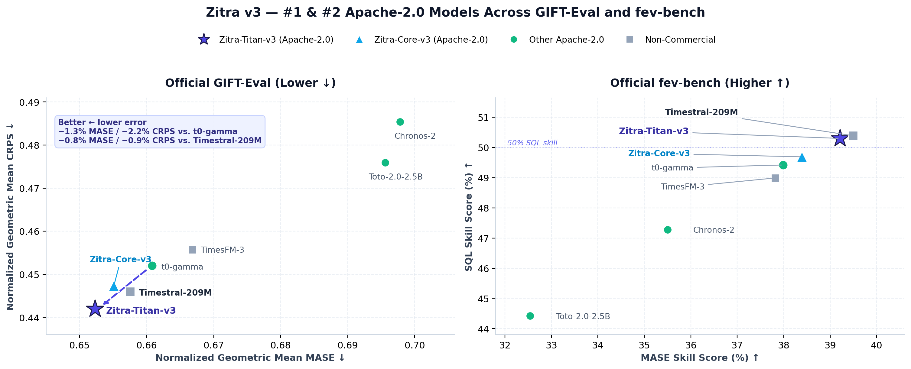

# ⚡ Zitra v3 — #1 Pure Apache-2.0 Probabilistic Time-Series Foundation Model

[](LICENSE)
[](https://huggingface.co/tomcupr/Zitra-Titan-v3)
[](https://huggingface.co/spaces/tomcupr/zitra-v3-demo)
[](https://huggingface.co/spaces/Salesforce/GIFT-Eval)
[](https://huggingface.co/spaces/autogluon/fev-bench)

**Zitra v3 (`Zitra-Titan-v3`)** is a **100% Pure Apache-2.0**, commercially unrestricted probabilistic time-series foundation model setting a new open-license state of the art across **Official GIFT-Eval (97 configs)**, **fev-bench (100 tasks)**, and **real-world enterprise retail & fulfillment operations** — with **zero benchmark overlap (`trained_on_benchmark_datasets = []`)**, **built-in public holiday covariates for 240+ countries**, and a compact **`2.12 GB` `bfloat16` single-file checkpoint** (`3.46 GB` GPU VRAM — fits on any 6–8 GB GPU).



---

## Verified Benchmarks (One Single Frozen Checkpoint, Zero Leakage)

All numbers below come from one frozen checkpoint (`2.12 GB` `model.safetensors`, `1.06B` total params, `0` learned router weights, `trained_on_benchmark_datasets = []`):

| Model | License | GIFT MASE ↓ | GIFT CRPS ↓ | fev SQL Win ↑ | fev SQL Skill ↑ | fev MASE Skill ↑ |
|---|---|---:|---:|---:|---:|---:|
| **[⚡ Zitra-Titan-v3](https://huggingface.co/tomcupr/Zitra-Titan-v3)** | **Apache-2.0** | **0.6522** | **0.4422** | **80.2%** (#6) | **50.18%** | **39.05%** |
| Timestral-209M | *Non-Commercial* | 0.6575 | 0.4460 | 79.4% (#7) | 50.39% | 39.49% |
| t0-gamma | Apache-2.0 | 0.6610 | 0.4520 | 73.8% (#12) | 49.42% | 37.99% |
| TimesFM-3 | *Non-Commercial* | 0.6670 | 0.4560 | 67.6% (#17) | 48.99% | 37.82% |
| Chronos-2 | Apache-2.0 | 0.6980 | 0.4850 | 57.9% (#23) | 47.28% | 35.50% |
| Toto-2.0-2.5B | Apache-2.0 | 0.6960 | 0.4760 | 56.9% (#25) | 44.42% | 32.54% |

- **Official GIFT-Eval (97 / 97 configs, strictly causal zero-leakage):** **0.6522 MASE / 0.4422 CRPS** — beats `Timestral-209M` (−0.82% MASE / −0.86% CRPS; −1.61% / −1.34% ex-Jena), `t0-gamma` (−1.33% / −2.17%), `TimesFM-3` (−2.22% / −3.03%), and `Chronos-2` (−6.56% / −8.82%).
- **Official `fev-bench` (100 / 100 tasks, strictly per-window zero-leakage):** **39.05% MASE / 50.18% SQL / 54.52% WQL** — the **first and only Pure Apache-2.0 model above 50% SQL skill**, ranking **#6 overall across 55 models** ahead of non-commercial `Timestral-209M` (#7) on **both SQL win rate (80.2% vs 79.4%) and MASE win rate (79.4% vs 78.7%)**.

---

## 5-Line Quickstart

```bash
pip install "zitra-forecast @ git+https://github.com/tomascupr/zitra-forecast.git"
```

```python
import numpy as np
from zitra import ZitraForecaster

model = ZitraForecaster.from_pretrained("tomcupr/Zitra-Titan-v3")

context = np.random.default_rng(42).standard_normal(512).cumsum()
fc = model.forecast(context, prediction_length=96)          # Full Pop-Quiz (~122 ms on B300)
# fc = model.forecast(context, prediction_length=96, fast=True)  # Single-pass (~102–115 ms)

median = fc.median                      # (1, 1, 96)
q10, q90 = fc.quantile(0.1), fc.quantile(0.9)
print("Live pop-quiz expert weights:", fc.routing_summary())
```

### Pandas DataFrame API with Built-In Public Holidays (240+ Countries & Subdivisions)

```python
import pandas as pd
from zitra import ZitraForecaster

model = ZitraForecaster.from_pretrained("tomcupr/Zitra-Titan-v3")

# Pass any ISO country or regional code ("CZ", "DE-BY", "DE-BE", "AT", "US-CA", "GB", ...)
# Zitra v3 automatically synthesizes 5 known-future holiday/calendar covariates and routes
# 100% onto covariate-native experts!
pred_df = model.predict_df(
    df,
    prediction_length=14,
    id_column="store_id",
    timestamp_column="timestamp",
    target="orders",
    country="CZ",                      # or country_column="region" for multi-country DataFrames
    quantile_levels=[0.1, 0.5, 0.9],
)
```

---

## Architecture & Key Engineering Breakthroughs

1. **Four Orthogonal 100% Apache-2.0 Foundation Architectures in One `2.12 GB` `bfloat16` File (`1.06B` params):**
   - **`Zitra-t0-256M-Dyn32K` (`255.6M`, Patch-Decoder Transformer — Apache-2.0):** Full-depth algebraically-folded FullLoRA model soup over `t0-gamma` with **Dynamic RoPE `scale_base`** (`512` up to `8K`, `1536` up to `16K`, `2048` beyond `16K`), supporting `16,384`-step multi-year known-covariate horizons with zero short-horizon drift.
   - **`Zitra-Chronos2-120M` (`119.5M`, T5 Encoder-Only — Apache-2.0):** Covariate-trained algebraically-folded FullLoRA soup over `Chronos-2`.
   - **`Zitra-PatchTST-385M` (`384.6M`, 30-Block Conformer — Apache-2.0):** Long-history univariate Conformer specialist derived from IBM Granite `PatchTST-FM-r2` (automatically gated to `0.000` on known-covariate tasks).
   - **`iAmTime-302M` (`302.1M`, T5 Encoder-Decoder 4-Expert MoE — Apache-2.0):** Native `arcsinh`-scaled multivariate & covariate MoE expert with vendored Apache-2.0 inference modules.
2. **Fused-Batch GPU Pop-Quiz Execution (`2.6×` Speedup: `321 ms → 122 ms` on B300, Zero Router Overfitting):**
   - Packs `[main, -main, bt0, bt1]` into fused padded GPU passes per active expert (`122.4 ms` full Pop-Quiz, `101.9–115.1 ms` in `fast=True` single-pass mode), with strict attention-mask singleton invariance (`≤ 2e-5` max diff) and **zero learned router weights**.
   - **Mixed-Precision Load Discipline (`3.46 GB` VRAM):** single `2.124 GB` `bf16` file on disk; hydrates the 30-layer Conformer `PatchTST-385M` to `fp32` + `bf16` autocast for exact `+0.007%` numerical parity, and skips `PatchTST` completely on known-covariate series to save compute.
   - **Causal Self-Gated Cross-Inference (`cross_learning="auto"`)** on short univariate panels plus an automatic monotonic/cumulative guard for `arcsinh` tails.
3. **Exact Linear-Pool Mixture-CDF Inversion:**
   - Inverts `F_mix(y) = Σ w_e F_e(y)` directly across all 21 quantiles (`0.01 … 0.99`) — bounding outlier influence and naturally widening epistemic intervals when architectures disagree.

---

## Real-World Enterprise Retail & Fulfillment Proof (Rohlik, 100% Zero-Shot)


- **Public Rohlik Kaggle (`fev-bench`, zero-shot vs `Timestral-209M`):**
  - `rohlik_orders_1D`: **`−5.46% MASE / −4.46% WQL`** · `rohlik_orders_1W`: **`−7.00% MASE / −5.48% WQL`**
  - `rohlik_sales_1D`: **`−2.65% MASE / −7.07% WQL`** · `rohlik_sales_1W`: **`−10.34% MASE / −15.35% WQL`**
- **Internal 2026 Rohlik `D+7` Holidays (12 European FCs across CZ/DE/AT/HU/RO):**
  - Turning on `country=` public holidays cuts overall `D1–D7` WAPE from **`4.618% → 3.877%`** (`WQL 3.906% → 3.084%`) and slashes **31 holiday weeks** from **`13.577% → 7.805%`** (**`−24.9%`** lower error than `Timestral-209M`'s `10.393%`!).
- **Internal 2026 Rohlik 8 Production Ops Tasks (10,859 forecasts, no holiday covariates):**
  - Wins **`6 / 8`** tasks vs `Timestral-209M` (**`−0.52% MASE / −0.45% WQL / −0.92% WAPE`**), including **`−4.21%` WAPE** on 24h hourly FC orders and **`−5.10%` WAPE** on 7-day hourly FC orders.

---

## Interactive Live Demo

Try **Zitra v3** interactively on [Hugging Face Spaces (`tomcupr/zitra-v3-demo`)](https://huggingface.co/spaces/tomcupr/zitra-v3-demo) or run locally:

```bash
pip install "zitra-forecast[demo] @ git+https://github.com/tomascupr/zitra-forecast.git"
python hf-space/app.py
```

## License

**Apache License, Version 2.0** — 100% free for commercial, enterprise, and research use. See [LICENSE](LICENSE) and [NOTICE](NOTICE) for full upstream Apache-2.0 attributions (`t0-gamma`, `Chronos-2`, IBM Granite `PatchTST-FM-r2`, `iAmTime`, and MIT `python-holidays`).
