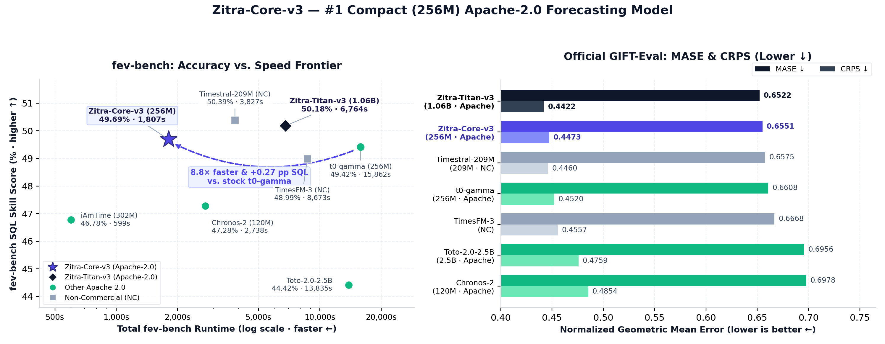
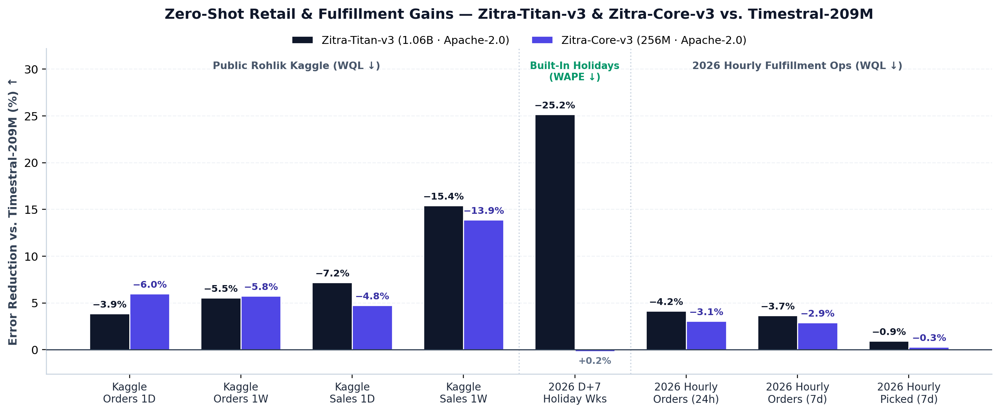

# ⚡ Zitra v3 — #1 Fully Open (Apache-2.0) Zero-Shot Forecasting Models

[](LICENSE)
[](https://huggingface.co/tomcupr/Zitra-Titan-v3)
[](https://huggingface.co/tomcupr/Zitra-Core-v3)
[](https://huggingface.co/spaces/tomcupr/zitra-v3-demo)

**Zitra v3** is a two-tier family of **100% Apache-2.0** zero-shot probabilistic time-series foundation models — ranked **#1 and #2 among all fully open (Apache-2.0) models** across both **GIFT-Eval** and **`fev-bench`**, with built-in public holidays for 240+ countries:

| Model | Params | GPU / 8-Core CPU | VRAM | GIFT-Eval (MASE ↓ / CRPS ↓) | `fev-bench` (SQL ↑ / Win ↑) | Best For |
|---|---:|---:|---:|---|---|---|
| **[⚡ Zitra-Titan-v3](https://huggingface.co/tomcupr/Zitra-Titan-v3)** | 1.06B | 68.5 ms / 893 ms | 2.70 GB | **0.6522 / 0.4422** | **50.18%** / **79.7%** (#6) | Flagship accuracy · holiday & capacity planning |
| **[⚡ Zitra-Core-v3](https://huggingface.co/tomcupr/Zitra-Core-v3)** | **256M** | **17.5 ms / 89 ms** | **1.07 GB** | **0.6551 / 0.4473** | **49.69%** / **75.5%** (#11) | High-throughput SKUs (`1,265/s`) · CPU & edge |



---

## Quickstart

```bash
pip install "zitra-forecast @ git+https://github.com/tomascupr/zitra-forecast.git"
```

```python
import numpy as np
from zitra import ZitraForecaster

# Flagship accuracy: "tomcupr/Zitra-Titan-v3"  |  4x faster GPU / 10x CPU: "tomcupr/Zitra-Core-v3"
model = ZitraForecaster.from_pretrained("tomcupr/Zitra-Core-v3")
ctx = np.random.default_rng(42).standard_normal(512).cumsum()
fc = model.forecast(ctx, prediction_length=96)

median, q10, q90 = fc.median, fc.quantile(0.1), fc.quantile(0.9)
```

**Pandas DataFrames with built-in public holidays** (`"CZ"`, `"DE-BY"`, `"US-CA"`, etc. — 240+ countries & subdivisions):

```python
pred_df = model.predict_df(
    df,
    prediction_length=14,
    id_column="store_id",
    timestamp_column="timestamp",
    target="orders",
    country="CZ",
    quantile_levels=[0.1, 0.5, 0.9],
)
```

---

## Verified Benchmarks (Single Frozen Checkpoints, Zero Leakage)

| Model | License | GIFT MASE ↓ | GIFT CRPS ↓ | fev SQL Win ↑ | fev SQL Skill ↑ | fev Runtime ↓ |
|---|---|---:|---:|---:|---:|---:|
| **[⚡ Zitra-Titan-v3](https://huggingface.co/tomcupr/Zitra-Titan-v3)** *(1.06B)* | **Apache-2.0** | **0.6522** | **0.4422** | **79.7%** (#6) | **50.18%** | 6,764 s |
| Timestral-209M | *Non-Commercial* | 0.6575 | 0.4460 | 78.8% (#7) | 50.39% | 3,827 s |
| **[⚡ Zitra-Core-v3](https://huggingface.co/tomcupr/Zitra-Core-v3)** *(256M)* | **Apache-2.0** | **0.6551** | **0.4473** | **75.5%** (#11) | **49.69%** | **1,807 s** |
| t0-gamma *(256M)* | Apache-2.0 | 0.6608 | 0.4520 | 72.9% (#13) | 49.42% | 15,862 s |
| TimesFM-3 | *Non-Commercial* | 0.6668 | 0.4557 | 66.9% (#18) | 48.99% | 8,673 s |
| Chronos-2 *(120M)* | Apache-2.0 | 0.6978 | 0.4854 | 56.9% (#24) | 47.28% | 2,738 s |
| Toto-2.0-2.5B *(2.5B)* | Apache-2.0 | 0.6956 | 0.4759 | 55.9% (#25) | 44.42% | 13,835 s |

- **`Zitra-Titan-v3`:** #1 fully open (Apache-2.0) model on both GIFT-Eval (`97/97`) and `fev-bench` (`100/100`), ahead of `Timestral-209M` on GIFT-Eval (`−0.82% / −0.86%`) and `fev-bench` win rate (`79.7%` vs. `78.8%` across 56 models).
- **`Zitra-Core-v3`:** #1 compact (`256M`) Apache-2.0 model on both leaderboards — beating `t0-gamma` (`−0.87% / −1.04%` GIFT; `+0.27 pp` SQL, `63/100` wins on `fev-bench`), `TimesFM-3`, `Chronos-2`, and `Toto-2.0-2.5B` while running **8.8× faster than `t0-gamma`**, **4.8× faster than `TimesFM-3`**, and **2.1× faster than `Timestral-209M`**.

### Real-World Enterprise Proof (Rohlik · 100% Zero-Shot)



- **Holiday weeks (12 European FCs, 2026 `D+7`):** `Zitra-Titan-v3` + built-in `country=` holidays cut overall WAPE **4.62% → 3.88%** and slash 31 holiday weeks **13.58% → 7.81%** (**−24.9%** vs. Timestral-209M's 10.39%).
- **High-volume SKU & hourly ops (8 tasks, 10,859 forecasts):** `Zitra-Titan-v3` wins **6 / 8** tasks vs. Timestral-209M (**−0.92% WAPE**); `Zitra-Core-v3` forecasts **10,000 SKUs in 7.9 s (`1,265 SKUs/sec`)** within **0.5–1.6% WAPE** of Titan (and beats Titan on 28-day SKU MASE & SQL).
- **Public Rohlik Kaggle (`fev-bench`):** Both models beat Timestral-209M on all 4 tasks (`Core-v3` WQL: **−6.0% / −5.8%** Orders 1D/1W, **−4.8% / −13.9%** Sales 1D/1W).

---

## Live Demo & License

Try both **`Zitra-Titan-v3`** and **`Zitra-Core-v3`** live on [Hugging Face Spaces (`tomcupr/zitra-v3-demo`)](https://huggingface.co/spaces/tomcupr/zitra-v3-demo), or run locally with `pip install "zitra-forecast[demo] @ git+https://github.com/tomascupr/zitra-forecast.git" && python hf-space/app.py`.

**Apache License, Version 2.0** — 100% free for commercial and research use. See [LICENSE](LICENSE) and [NOTICE](NOTICE).
