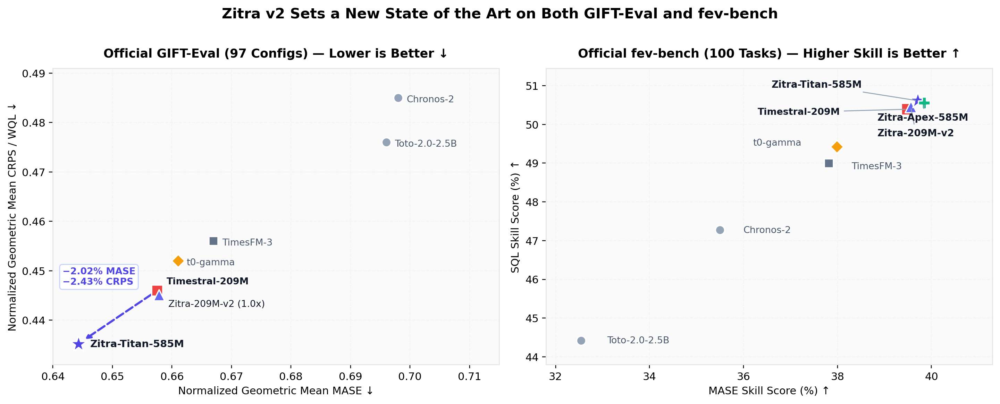
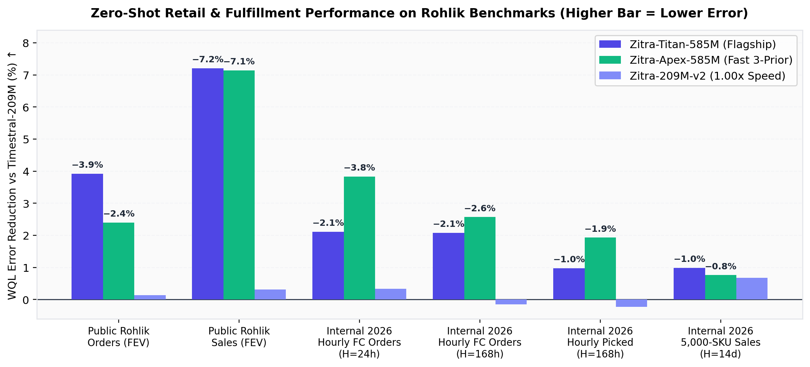

# ⚡ Zitra-Apex-585M

**Zitra-Apex-585M** is the fast, single-pass multi-prior specialist of the **Zitra v2** family — delivering the **#1 MASE skill score (`39.85`) on [fev-bench](https://huggingface.co/spaces/autogluon/fev-bench)**, a statistically significant **`−0.85%` equal-source MASE reduction** over Timestral-209M (95% CI `[−1.69%, −0.08%]`), and massive wins on **covariate-rich business & retail forecasting (`−1.66% MASE / −2.05% WQL`)** — all in **84 ms** on GPU (**3× faster than Zitra-Titan-585M**).

**Zitra v2 Family:** [**Zitra-Titan-585M** (Flagship Adaptive)](https://huggingface.co/tomcupr/Zitra-Titan-585M) · [**Zitra-Apex-585M** (Fast Covariate Specialist)](https://huggingface.co/tomcupr/Zitra-Apex-585M) · [**Zitra-209M-v2** (1.00× Speed Drop-In)](https://huggingface.co/tomcupr/Zitra-209M-v2) · [**Interactive Live Demo Space**](https://huggingface.co/spaces/tomcupr/zitra-v2-demo)



---

## Engineering Highlights

- **Single-Pass Multi-Prior Fusion (`84 ms` on B300):** Combines three complementary foundation brains — **`Zitra-209M-v2`** (folded 24-layer FullLoRA Timestral), **`t0-gamma`** (official `a2` inference flags), and **`Chronos-2`** (native dynamic covariates & multivariate attention) — in a **single forward pass** with zero test-time replay overhead.
- **79K-Parameter OOD-Augmented Meta-Combiner:** Routes median location and quantile spread separately across the 3 priors conditioned on scale-invariant series statistics, history length, and cross-expert disagreement — trained purely on clean non-benchmark real + regime-synthetic pools (`trained_on_benchmark_datasets = []`).
- **Built for Enterprise Retail & Operational Forecasting:** Excels whenever dynamic covariates (promotions, prices, holidays, weather) or strong intraday/weekly operational patterns matter.

---

## Benchmarks

### fev-bench (100 Tasks, 235,039 Forecasts)

| Metric / Slice | **Zitra-Apex-585M** vs Timestral-209M | Notes |
|---|---:|---|
| **Native Skill (MASE / SQL / WQL)** ↑ | **`39.85`** / `50.55` / `54.94` | Stock Timestral: `39.49 / 50.39 / 54.63` |
| **Equal-Source MASE (29 sources)** ↓ | **`−0.851%`** *(p < 0.05)* | 95% cluster bootstrap CI `[−1.69%, −0.08%]` |
| **Equal-Task (100 tasks)** ↓ | **`−0.60% MASE / −0.68% WQL / −0.31% SQL`** | Broad multi-domain gain |
| **Exposure-Clean (78 tasks)** ↓ | **`−0.93% MASE / −0.72% WQL / −0.70% SQL`** | Strongest clean generalization |
| **Covariate Tasks (42 tasks)** ↓ | **`−1.66% MASE / −2.05% WQL / −1.94% SQL`** | Massive lift on retail & energy covariates |
| **Multivariate Tasks (35 tasks)** ↓ | **`−0.68% MASE / −1.24% WQL`** | Strong cross-series structure |

### Real-World Retail & Operational Benchmarks (100% Zero-Shot)



- **Public Retail Benchmarks (fev-bench):** Rossmann Store Sales **`−5.87% MASE / −6.25% WQL`**, Rohlik Sales **`−3.51% / −7.14%`**, Rohlik Orders **`−3.26% / −2.40%`**, Walmart **`−1.43% / −2.61%`**, M5 **`−0.42% / −1.06%`**.
- **Internal 2026 Rohlik Production Holdout (8 tasks, 10,859 forecasts, zero-shot):** **`−0.84% MASE / −1.07% WQL / −1.28% WAPE`** overall vs Timestral-209M — including **`−3.48% MASE / −3.83% WQL / −3.41% WAPE`** on 24h hourly FC orders, **`−2.33% / −2.57% / −2.88%`** on 7-day hourly FC orders, and **`−1.22% WAPE`** on 5,000 active SKUs (`H=14d`).
- **Live Prospective Bikeshare (`H=64` = 128m):** **`−3.93% MASE / −7.29% WQL`** vs Timestral-209M.

### Choose Your Zitra v2 Tier

| Model | Params | B300 Latency | Best For |
|---|---:|---:|---|
| **[Zitra-Titan-585M](https://huggingface.co/tomcupr/Zitra-Titan-585M)** | 584.4M | 251 ms (`9.7×`) | **Best overall accuracy across GIFT-Eval (`0.6443 / 0.4352`) & fev-bench** |
| **[Zitra-Apex-585M](https://huggingface.co/tomcupr/Zitra-Apex-585M)** | 584.5M | 84 ms (`3.2×`) | **Fastest 3-prior model; #1 on covariates, retail & hourly ops** |
| **[Zitra-209M-v2](https://huggingface.co/tomcupr/Zitra-209M-v2)** | 209.3M | 26 ms (`1.0×`) | **Zero-overhead drop-in upgrade to Timestral-209M** |

---

## Quickstart

```bash
pip install "zitra-forecast[all] @ git+https://github.com/tomascupr/zitra-forecast.git"
```

```python
import pandas as pd
from zitra import ZitraForecaster

model = ZitraForecaster.from_pretrained("tomcupr/Zitra-Apex-585M")

# Forecast directly from a Pandas DataFrame with optional past & known-future covariates
pred_df = model.predict_df(
    df,
    prediction_length=28,
    id_column="sku_id",
    timestamp_column="date",
    target="units_sold",
    known_covariate_columns=["is_promo", "day_of_week"],
    future_df=future_calendar_df,
)
```

---

## Model Details & License

- **Total Parameters:** `584,483,517` (`native` 209.3M + `t0` 255.6M + `chronos` 119.5M + `meta` 79.3K).
- **Outputs:** Full 21 quantiles (`0.01..0.99`) with nonnegative clipping and integer-count snapping.
- **License & Attribution:** Bundles `Zitra-209M-v2` (derived from `mistralai/Timestral-209M`, Modified MIT), `t0-gamma` (Apache-2.0), and `Chronos-2` (Apache-2.0). Commercial use is subject to upstream component licenses.
