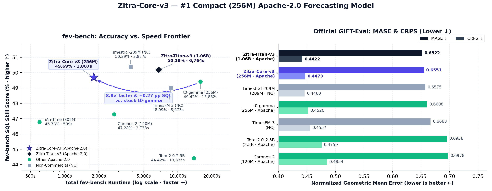

# ⚡ Zitra-Core-v3

**#1 Compact (256M) Fully Open (Apache-2.0) Time-Series Foundation Model** — outperforming `t0-gamma`, `TimesFM-3`, `Chronos-2`, and `Toto-2.0-2.5B` across both **GIFT-Eval** and **`fev-bench`**, at **8.8× the throughput of `t0-gamma`** (**17.5 ms** GPU · **87 ms** CPU).

Distilled from our flagship [`Zitra-Titan-v3`](https://huggingface.co/tomcupr/Zitra-Titan-v3), `Zitra-Core-v3` also runs **4.8× faster than `TimesFM-3`**, **2.1× faster than `Timestral-209M`**, and **1.5× faster than `Chronos-2`** — in just **1.07 GB VRAM** with built-in public holidays for 240+ countries.

[**Live Demo Space**](https://huggingface.co/spaces/tomcupr/zitra-v3-demo) · [**Flagship `Zitra-Titan-v3`**](https://huggingface.co/tomcupr/Zitra-Titan-v3) · [**GitHub SDK (`zitra-forecast`)**](https://github.com/tomascupr/zitra-forecast) · [**GIFT-Eval CSV**](gift_eval_results.csv) · [**fev-bench CSV**](fev_bench_results.csv)



---

## Quickstart

```bash
pip install "zitra-forecast @ git+https://github.com/tomascupr/zitra-forecast.git"
```

```python
import numpy as np
from zitra import ZitraForecaster

model = ZitraForecaster.from_pretrained("tomcupr/Zitra-Core-v3")
ctx = np.random.default_rng(42).standard_normal(512).cumsum()
fc = model.forecast(ctx, prediction_length=96)  # 17.5 ms GPU · 87 ms CPU

median, q10, q90 = fc.median, fc.quantile(0.1), fc.quantile(0.9)
```

**Pandas DataFrames with built-in public holidays** (`"CZ"`, `"DE-BY"`, `"US-CA"`, etc. — 240+ countries & subdivisions):

```python
pred_df = model.predict_df(
    df,
    prediction_length=14,
    id_column="store_id",
    timestamp_column="timestamp",
    target="orders",
    country="CZ",
    quantile_levels=[0.1, 0.5, 0.9],
)
```

---

## Verified Benchmarks

Every number below comes from this single frozen checkpoint with strictly causal evaluation and zero test-data leakage (`0.0%` `fev-bench` overlap).

### Official `fev-bench` (Accuracy & Speed · higher skill ↑, lower time ↓)

| Rank | Model | License | SQL Win ↑ | SQL Skill ↑ | MASE Skill ↑ | Total Runtime ↓ | Speedup |
|---:|---|---|---:|---:|---:|---:|---:|
| #6 | [⚡ Zitra-Titan-v3](https://huggingface.co/tomcupr/Zitra-Titan-v3) *(1.06B)* | Apache-2.0 | 79.7% | 50.18% | 39.05% | 6,764 s | 3.7× slower |
| #7 | Timestral-209M | *Non-Commercial* | 78.8% | 50.39% | 39.49% | 3,827 s | 2.1× slower |
| **#11** | **⚡ Zitra-Core-v3** *(256M)* | **Apache-2.0** | **75.5%** | **49.69%** | **38.39%** | **1,807 s** | **1.0× (baseline)** |
| #13 | t0-gamma *(256M)* | Apache-2.0 | 72.9% | 49.42% | 37.99% | 15,862 s | **8.8× slower** |
| #18 | TimesFM-3 | *Non-Commercial* | 66.9% | 48.99% | 37.82% | 8,673 s | **4.8× slower** |
| #22 | iAmTime *(302M)* | Apache-2.0 | 60.5% | 46.78% | 35.36% | 599 s | 3.0× faster |
| #24 | Chronos-2 *(120M)* | Apache-2.0 | 56.9% | 47.28% | 35.50% | 2,738 s | **1.5× slower** |
| #25 | Toto-2.0-2.5B *(2.5B)* | Apache-2.0 | 55.9% | 44.42% | 32.54% | 13,835 s | **7.7× slower** |

*Evaluated across all 100 tasks (`53.76%` WQL skill, `73.5%` MASE win rate — #11 / 56 models on both SQL and MASE win rate). Beats stock `t0-gamma` on **63 / 100** tasks at **8.8×** higher throughput (`4.91 s` vs. `16.25 s` median). The only Apache-2.0 model ranked higher is our own `Zitra-Titan-v3`.*

### Official GIFT-Eval (lower is better ↓)

| Model | License | MASE ↓ | CRPS ↓ | Core-v3 Gain (MASE / CRPS) |
|---|---|---:|---:|---:|
| [⚡ Zitra-Titan-v3](https://huggingface.co/tomcupr/Zitra-Titan-v3) *(1.06B)* | Apache-2.0 | 0.6522 | 0.4422 | +0.44% / +1.15% |
| **⚡ Zitra-Core-v3** *(256M)* | **Apache-2.0** | **0.6551** | **0.4473** | — |
| Timestral-209M | *Non-Commercial* | 0.6575 | 0.4460 | **−0.38%** / +0.29% |
| Timestral-123M | *Non-Commercial* | 0.6589 | 0.4476 | **−0.58% / −0.07%** |
| t0-gamma *(256M)* | Apache-2.0 | 0.6608 | 0.4520 | **−0.87% / −1.04%** |
| TimesFM-3 | *Non-Commercial* | 0.6668 | 0.4557 | **−1.76% / −1.84%** |
| iAmTime *(302M)* | Apache-2.0 | 0.6795 | 0.4647 | **−3.60% / −3.74%** |
| Toto-2.0-2.5B *(2.5B)* | Apache-2.0 | 0.6956 | 0.4759 | **−5.83% / −6.01%** |
| Chronos-2 *(120M)* | Apache-2.0 | 0.6978 | 0.4854 | **−6.13% / −7.85%** |

*Evaluated across all 97 configs. Outperforms every third-party Apache-2.0 model of any size (including 10× larger `Toto-2.0-2.5B`), beats `Timestral-123M` on both metrics, and beats `Timestral-209M` on MASE (`−0.93% MASE / −0.06% CRPS` ex-Jena).*

<details>
<summary><b>Real-world enterprise throughput &amp; raw CSVs (Rohlik · 100% Zero-Shot)</b></summary>

- **High-volume SKU &amp; hourly ops (8 tasks, 10,859 forecasts):** Forecasts **10,000 daily SKUs in 7.9 s (`1,265 SKUs/sec` on B300 — `16.8×` faster than `Zitra-Titan-v3`)** while staying within **0.5–1.6% WAPE** of `Titan-v3` on SKU and hourly warehouse ops (and beating `Titan-v3` on 28-day SKU MASE `1.260` vs. `1.287` and SQL `1.079` vs. `1.094`).
- **Public Rohlik Kaggle (`fev-bench` WQL):** Cuts error vs. `Timestral-209M` across all 4 tasks — Orders 1D (**−5.98%**), Orders 1W (**−5.75%**), Sales 1D (**−4.75%**), Sales 1W (**−13.90%**), edging `Zitra-Titan-v3` on both Orders tasks.
- **Full benchmark CSVs:** [`gift_eval_results.csv`](gift_eval_results.csv) · [`fev_bench_results.csv`](fev_bench_results.csv).

</details>

---

## Speed, Hardware & When to Choose Core vs. Titan

Measured directly on **NVIDIA B300 GPU** and **8 CPU threads (Intel Xeon 6776P, `fp32`, no GPU)**:

| Metric | ⚡ Zitra-Core-v3 *(256M)* | ⚡ Zitra-Titan-v3 *(1.06B)* | Core-v3 Advantage |
|---|---:|---:|---|
| **B300 GPU (Standard / `fast=True`)** | **17.5 ms / 15.9 ms** | 122 ms / 115 ms | **7.0× faster** |
| **B300 GPU (Known Covariates)** | **35.6 ms** | 174 ms | **4.9× faster** |
| **8-Core CPU (Standard / `fast=True`)** | **87 ms / 69 ms** | 952 ms / 567 ms | **11× faster** *(faster than Titan on GPU!)* |
| **CPU Cold Load Time** | **1.8 s** | 9.8 s | **5.4× faster** |
| **GPU VRAM / CPU RAM** | **1.07 GB / ~1.2 GB** | 3.46 GB / ~4.3 GB | **3.2–3.6× smaller** |
| **Batch SKU Throughput (B300)** | **1,265 SKUs/sec** | 75 SKUs/sec | **16.8× higher** |

- **Choose `Zitra-Core-v3`** for CPU-only / serverless / edge deployments, high-volume 100K–1M SKU pipelines, and latency-critical real-time serving.
- **Choose [`Zitra-Titan-v3`](https://huggingface.co/tomcupr/Zitra-Titan-v3)** for maximum accuracy on high-stakes capacity, energy, and public-holiday planning where 4-architecture Pop-Quiz routing gives the final edge.

---

## Engineering Highlights

- **Head-Preserving Multi-Architecture Distillation:** Distilled from our 4-architecture `Zitra-Titan-v3` teacher (Patch-Decoder + T5 Encoder + 30L Conformer + T5 4-MoE) across ~50K strictly zero-leakage real and structured series with surprise-weighted 21-quantile Wasserstein-1 loss. Keeping the pretrained patch encoder and 21-quantile decoder head frozen while adapting all 96 transformer layers + `WiSE-FT` weight-space interpolation (`α = 0.45`) transfers multi-architecture covariate sharpness and tail calibration without distorting pretrained scale.
- **Adaptive TF32 / `bf16` Precision Guard (`2×` speedup + zero truncation):** Automatically runs `fp32` (TF32 Tensor Cores on CUDA) on `T ≤ 2,048` and high-offset cumulative/macro series — eliminating `bfloat16` 7-bit mantissa truncation while doubling throughput over autocast — and switches to `bf16` FlashAttention on long contexts (`T > 2,048`).
- **Fused Sign-Equivariant Mirroring & Causal Cross-Learning:** Packs `[+x, -x]` into a single fused GPU pass (adding just 1.6 ms over single-pass `fast=True`), applies Bayesian-shrinkage cross-learning on short panels (`T ≤ 96`) and strictly causal historical backtest gating on longer panels (`cross_learning="auto"`), and guarantees exact **`0.00e+00`** singleton vs. batched invariance with `cross_learning=False`.
- **Zero Runtime Overhead:** All LoRA deltas are algebraically folded into a single `bfloat16` `safetensors` checkpoint (`255.6M` params, 21-quantile grid `0.01–0.99`, native `8,192` context with automatic Dynamic-RoPE extension beyond 8K).

---

## License

**Apache License, Version 2.0** — 100% free for commercial and research use. See [`LICENSE`](LICENSE) and [`NOTICE`](NOTICE) for full attributions.
