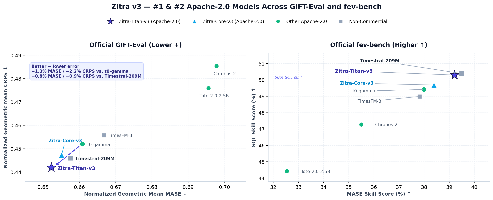
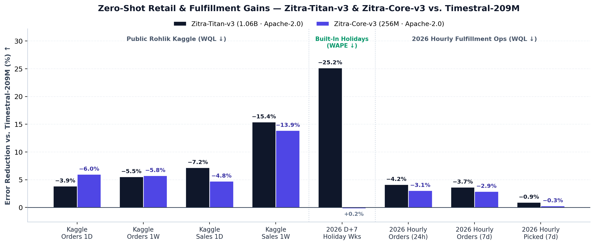

# ⚡ Zitra-Titan-585M

**Zitra-Titan-585M** is the flagship model of the **Zitra v2** time-series forecasting family — setting a new state of the art on **both** [Official GIFT-Eval](https://huggingface.co/spaces/Salesforce/GIFT-Eval) (**`0.6443 MASE / 0.4352 CRPS`**, beating Mistral's Timestral-209M by **`−2.02% / −2.43%`** across 97 tasks) and [fev-bench](https://huggingface.co/spaces/autogluon/fev-bench) (**`50.61 SQL / 54.95 WQL / 39.71 MASE` skill**, winning every univariate, multivariate, covariate, and no-covariate slice).

**Zitra v2 Family:** [**Collection**](https://huggingface.co/collections/tomcupr/zitra-v2-time-series-foundation-models-6b07f1ff7bd52f98a455d847) · [**Zitra-Titan-585M** (Flagship Adaptive)](https://huggingface.co/tomcupr/Zitra-Titan-585M) · [**Zitra-Apex-585M** (Fast Covariate Specialist)](https://huggingface.co/tomcupr/Zitra-Apex-585M) · [**Zitra-209M-v2** (1.00× Speed Drop-In)](https://huggingface.co/tomcupr/Zitra-209M-v2) · [**Interactive Live Demo Space**](https://huggingface.co/spaces/tomcupr/zitra-v2-demo)



---

## Why Zitra-Titan-585M Works So Well

Most forecasting models force every series — whether it's hourly solar generation, grocery SKU demand, cloud telemetry, or city bike counts — through one frozen inductive bias. **Zitra-Titan-585M** packs **three complementary, commercially permissive foundation priors** into a single `safetensors` checkpoint and adapts dynamically to *your* series at inference time with **zero learned router weights**:

1. **Three Orthogonal Foundation Brains in One File (`584.4M` params):**
   - **`Zitra-209M-v2` (209.3M):** Our 5-seed, 24-layer FullLoRA model soup algebraically folded into `Timestral-209M` (cross-variate + time RoPE decoder, up to 32,768 context).
   - **`t0-gamma` (255.6M, Apache-2.0):** Patch-decoder specialist configured with its full official `a2` inference settings (`trim_leading_missing`, symmetric averaging, nonnegativity, integer snapping, 8,192 context).
   - **`Chronos-2` (119.5M, Apache-2.0):** Encoder-only foundation prior with native multivariate and dynamic past/future covariate support.
2. **Test-Time Causal Pop-Quiz Routing (Zero Router Overfitting):**
   - Before predicting the future, `Zitra-Titan-585M` runs two covariate-preserving causal rolling backtests on the recent history of each series, shrinking relative log-losses by exact effective backtest sample size `n_eff / (n_eff + κ)` and cross-cutoff sign consistency to form an unclamped Bayesian posterior `w ∈ Δ³`.
3. **Exact Piecewise-Linear Mixture-CDF Inversion:**
   - Instead of naively averaging quantiles (Vincentization, which has an unbounded outlier influence function), `Zitra-Titan-585M` constructs the exact linear-pool cumulative distribution `F_mix(y) = Σ w_e F_e(y)` and inverts it at every decile. This gives **bounded influence against outlier hallucinations** (20× safer under simultaneous multi-expert failure) and **automatic epistemic uncertainty widening** when experts disagree.

---

## Benchmarks

Zero GIFT-Eval or fev-bench datasets were used during post-training or model selection (`trained_on_benchmark_datasets = []`).

### Zitra-Titan-585M vs Leading Open Foundation Models

| Benchmark | Metric | **Zitra-Titan-585M** | **Zitra-Apex-585M** | **Zitra-209M-v2** | Timestral-209M | t0-gamma | TimesFM-3 | Toto-2.0-2.5B | Chronos-2 |
|---|---|---:|---:|---:|---:|---:|---:|---:|---:|
| **GIFT-Eval** *(97 configs)* | MASE ↓ | **0.6443** | 0.6569 | 0.6578 | 0.6575 | 0.661 | 0.667 | 0.696 | 0.698 |
| | CRPS / WQL ↓ | **0.4352** | 0.4469 | 0.4451 | 0.4460 | 0.452 | 0.456 | 0.476 | 0.485 |
| **fev-bench** *(100 tasks)* | SQL Skill ↑ | **50.61** | 50.55 | 50.45 | 50.39 | 49.42 | 48.99 | 44.42 | 47.28 |
| | WQL Skill ↑ | **54.95** | 54.94 | 54.81 | 54.63 | — | — | — | — |
| | MASE Skill ↑ | 39.71 | **39.85** | 39.56 | 39.49 | 37.99 | 37.82 | 32.54 | 35.50 |

- **Official GIFT-Eval Highlights:** **`−2.02% MASE / −2.43% CRPS`** overall vs Timestral-209M (**`11/19` families won on both metrics**; **`−2.54% / −2.73%`** ex-Jena; **`−0.39%` WQL ex-solar** with `10/18` non-solar families won, including `loop_seattle −2.39%/−2.88%`, `bitbrains −0.13%/−1.92%`, `bizitobs −0.18%/−1.65%`, `m4 −0.33%/−1.13%`, `car_parts −0.51%/−1.04%`, `restaurant −0.69%/−0.81%`, `solar −24.12%/−22.49%`).
- **Official fev-bench Highlights:** Wins **all 4 benchmark slices** on both MASE & WQL — Covariate (`−0.80% / −1.16%`), Multivariate (`−0.32% / −1.00%`), Univariate (`−0.38% / −0.56%`), and No-Covariate (`−0.04% / −0.39%`), with statistically significant 29-source SQL improvement (`−0.58%`, 95% CI `[−1.18%, −0.01%]`).

### Real-World Enterprise Retail & Live Prospective Proof (100% Zero-Shot)



- **Public Rohlik Kaggle Retail (fev-bench, zero-shot):** **`−3.99% MASE / −3.92% WQL`** on Rohlik Orders and **`−3.74% MASE / −7.21% WQL`** on Rohlik SKU Sales (8,058 forecasts).
- **Internal 2026 Rohlik Production Holdout (8 operational tasks, 10,859 forecasts, zero-shot):** Wins **7/8 tasks** (`−0.83% MASE / −0.99% WQL / −1.05% WAPE` average vs Timestral-209M), including **`−2.24% MASE / −2.60% WAPE`** on 7-day hourly FC order planning, **`−1.96% / −2.18%`** on 24h hourly FC orders, and **`−1.23% MASE`** on 28-day 5,000-SKU demand.
- **Live Sealed Prospective Bikeshare Trial (96 stations, Montreal + Washington, `H=64` = 128m):** Sealed 8.3 minutes strictly before target start → **`−4.88% MASE / −7.58% WQL`** vs Timestral-209M (beats stock in both cities on both metrics).

### Choose Your Zitra v2 Tier

| Model | Params | B300 Latency | Best For |
|---|---:|---:|---|
| **[Zitra-Titan-585M](https://huggingface.co/tomcupr/Zitra-Titan-585M)** | 584.4M | 251 ms (`9.7×`) | **Maximum overall accuracy & calibrated quantiles across all domains** |
| **[Zitra-Apex-585M](https://huggingface.co/tomcupr/Zitra-Apex-585M)** | 584.5M | 84 ms (`3.2×`) | **Fast multi-prior retail / business forecasting with rich covariates** |
| **[Zitra-209M-v2](https://huggingface.co/tomcupr/Zitra-209M-v2)** | 209.3M | 26 ms (`1.0×`) | **Zero-overhead drop-in upgrade to stock Timestral-209M** |

---

## Quickstart

### Install

```bash
pip install "zitra-forecast[all] @ git+https://github.com/tomascupr/zitra-forecast.git"
```

### 5-Line Forecast (NumPy / PyTorch)

```python
import numpy as np
from zitra import ZitraForecaster

model = ZitraForecaster.from_pretrained("tomcupr/Zitra-Titan-585M")

context = np.random.default_rng(42).standard_normal(512).cumsum()
fc = model.forecast(context, prediction_length=96)

median = fc.median                      # (1, 1, 96)
q10, q90 = fc.quantile(0.1), fc.quantile(0.9)
print("Live pop-quiz expert weights:", fc.routing_summary())
```

### Forecast Directly from a Pandas DataFrame (with Optional Covariates)

```python
import pandas as pd
from zitra import ZitraForecaster

model = ZitraForecaster.from_pretrained("tomcupr/Zitra-Titan-585M")

df = pd.read_csv("https://autogluon.s3.us-west-2.amazonaws.com/datasets/timeseries/misc/AirPassengers.csv")
pred_df = model.predict_df(
    df,
    prediction_length=36,
    id_column="item_id",
    timestamp_column="Month",
    target="#Passengers",
    quantile_levels=[0.1, 0.5, 0.9],
)
```

---

## Model Details

- **Total Parameters:** `584,404,213` (`native` 209.3M + `t0` 255.6M + `chronos` 119.5M; **0 learned router weights**).
- **Context Length:** Up to `32,768` steps (native branch) / `8,192` steps (`t0-gamma` & `Chronos-2`).
- **Outputs:** Full 21 quantile grid (`0.01, 0.05, 0.10, …, 0.90, 0.95, 0.99`) with automatic nonnegative clipping and integer-count snapping when historical support matches.
- **Inputs:** Univariate & multivariate targets, past-only covariates, and known-future covariates (numeric & categorical); missing values supported as `NaN`.

## License & Upstream Attribution

This single-file checkpoint bundles three open-weight foundation components:
- **`native.*` (`Zitra-209M-v2`)**: Derived from [`mistralai/Timestral-209M`](https://huggingface.co/mistralai/Timestral-209M) under the **Modified MIT License**.
- **`t0.*` (`t0-gamma`)**: [`theforecastingcompany/t0-gamma`](https://huggingface.co/theforecastingcompany/t0-gamma) under **Apache-2.0**.
- **`chronos.*` (`Chronos-2`)**: [`amazon/chronos-2`](https://huggingface.co/amazon/chronos-2) under **Apache-2.0**.

Commercial use is subject to the upstream component licenses (including the Timestral Modified MIT terms).
