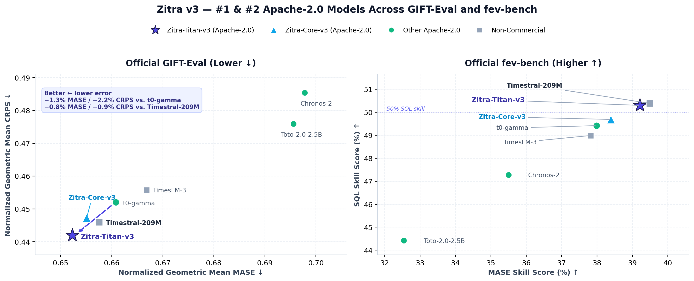
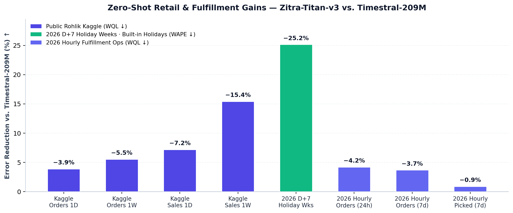

# ⚡ Zitra-Titan-v3

**#1 Fully Open (Apache-2.0) Time-Series Foundation Model** — outperforming `Timestral-209M`, `t0-gamma`, `TimesFM-3`, `Chronos-2`, and `Toto-2.0-2.5B` across both **GIFT-Eval** and **`fev-bench`**, with built-in public holidays for 240+ countries.

**Top 5 on `fev-bench` WQL (`#5`) and `#6` on SQL & MASE** *(56 models — `#1` Apache-2.0)* · **2.8× faster than `t0-gamma`**, **2.4× faster than `Toto-2.0-2.5B`**, **1.5× faster than `TimesFM-3`** · **3.5 GB VRAM** *(runs on any 6 GB GPU or CPU)*.

[**Live Demo Space**](https://huggingface.co/spaces/tomcupr/zitra-v3-demo) · [**Compact `Zitra-Core-v3` (256M · 4× GPU / 11× CPU Faster)**](https://huggingface.co/tomcupr/Zitra-Core-v3) · [**GitHub SDK (`zitra-forecast`)**](https://github.com/tomascupr/zitra-forecast) · [**GIFT-Eval CSV**](gift_eval_results.csv) · [**fev-bench CSV**](fev_bench_results.csv)



---

## Quickstart

```bash
pip install "zitra-forecast @ git+https://github.com/tomascupr/zitra-forecast.git"
```

```python
import numpy as np
from zitra import ZitraForecaster

model = ZitraForecaster.from_pretrained("tomcupr/Zitra-Titan-v3")
ctx = np.random.default_rng(42).standard_normal(512).cumsum()
fc = model.forecast(ctx, prediction_length=96)  # fast=True skips backtest routing

median, q10, q90 = fc.median, fc.quantile(0.1), fc.quantile(0.9)
print(fc.routing_summary())  # Per-series expert weights
```

**Pandas DataFrames with built-in public holidays** (`"CZ"`, `"DE-BY"`, `"US-CA"`, etc. — 240+ countries & subdivisions):

```python
pred_df = model.predict_df(
    df,
    prediction_length=14,
    id_column="store_id",
    timestamp_column="timestamp",
    target="orders",
    country="CZ",
    quantile_levels=[0.1, 0.5, 0.9],
)
```

---

## Verified Benchmarks

Every score below comes from this exact frozen checkpoint with strictly causal evaluation and **0.0% benchmark data overlap**.

### Official `fev-bench` (higher skill ↑ · lower runtime ↓)

| # | Model | License | Win Rate ↑ | SQL ↑ | MASE ↑ | Runtime ↓ |
|---:|---|---|---:|---:|---:|---:|
| **6** | **⚡ Zitra-Titan-v3** | **Apache-2.0** | **80.1%** | **50.30%** | **39.21%** | **5,719 s** |
| 7 | Timestral-209M | Non-Comm. | 78.7% | 50.39% | 39.49% | 3,827 s |
| 11 | [Zitra-Core-v3](https://huggingface.co/tomcupr/Zitra-Core-v3) | Apache-2.0 | 75.4% | 49.69% | 38.39% | **1,807 s** |
| 13 | t0-gamma | Apache-2.0 | 72.9% | 49.42% | 37.99% | 15,862 s |
| 18 | TimesFM-3 | Non-Comm. | 66.8% | 48.99% | 37.82% | 8,673 s |
| 22 | iAmTime | Apache-2.0 | 60.5% | 46.78% | 35.36% | 599 s |
| 24 | Chronos-2 | Apache-2.0 | 56.9% | 47.28% | 35.50% | 2,738 s |
| 25 | Toto-2.0-2.5B | Apache-2.0 | 55.9% | 44.42% | 32.54% | 13,835 s |

*First and only standard Apache-2.0 model past **80% SQL win rate** and **50% SQL skill**. Also ranks **#5 / 56 on WQL win rate (78.9%, 54.60% skill)** and **#6 / 56 on MASE win rate (79.4%)**. Outperforms `Timestral-209M` across all **78 zero-overlap tasks** (`−0.16%` SQL), all **29 equal-weight data sources** (`−0.90%` SQL), and all **42 covariate tasks** (`−0.75%` SQL). Ranks #1–#5 on SQL are closed APIs, non-commercial, or non-Apache.*

### Official GIFT-Eval (lower is better ↓)

| Model | License | MASE ↓ | CRPS ↓ | Titan-v3 Gain (MASE / CRPS) |
|---|---|---:|---:|---:|
| **⚡ Zitra-Titan-v3** | **Apache-2.0** | **0.6523** | **0.4420** | — |
| [Zitra-Core-v3](https://huggingface.co/tomcupr/Zitra-Core-v3) | Apache-2.0 | 0.6551 | 0.4473 | −0.4% / −1.2% |
| Timestral-209M | Non-Comm. | 0.6575 | 0.4460 | **−0.8% / −0.9%** |
| t0-gamma | Apache-2.0 | 0.6608 | 0.4520 | **−1.3% / −2.2%** |
| TimesFM-3 | Non-Comm. | 0.6668 | 0.4557 | **−2.2% / −3.0%** |
| Toto-2.0-2.5B | Apache-2.0 | 0.6956 | 0.4759 | **−6.2% / −7.1%** |
| Chronos-2 | Apache-2.0 | 0.6978 | 0.4854 | **−6.5% / −8.9%** |

*#1 among all zero-shot commercially licensed open-weight models on GIFT-Eval.*

<details>
<summary><b>Per-dataset highlights &amp; raw CSVs</b></summary>

- **GIFT-Eval vs. Timestral-209M (`−1.58% MASE / −1.37% CRPS` ex-Jena):** `solar` (−26.4% / −24.4%), `temperature_rain` (−9.9% / −16.2%), `kdd_cup_2018` (−4.5% / −5.3%), `loop_seattle` (−3.4% / −4.0%), `hospital` (−0.9% / −2.8%), `hierarchical_sales` (−1.2% / −1.4%), `restaurant` (−0.9% / −1.1%). Full 97-row CSV: [`gift_eval_results.csv`](gift_eval_results.csv).
- **`fev-bench` vs. Timestral-209M:** `uk_covid_nation_1W` (−32.1% SQL), `epf_de` (−22.3% SQL), `fred_md_2025/cee` (−19.4% SQL), `rohlik_sales_1W` (−15.4% WQL), `solar_1W` (−13.2% SQL). Full 100-row CSV: [`fev_bench_results.csv`](fev_bench_results.csv).

</details>

### Real-World Enterprise Proof (Rohlik · Zero-Shot)



- **Holiday weeks (12 European FCs, 2026 `D+7`):** Built-in `country=` holidays cut overall WAPE **4.62% → 3.84%** and slash 31 holiday weeks **13.58% → 7.78%** (**−25.2%** vs. `Timestral-209M`'s 10.39%).
- **Production ops (10,859 forecasts, no holidays):** Beats `Timestral-209M` on **6 / 8** tasks, cutting 24h and 7d hourly FC order error by **−4.2%** and **−3.7%**.
- **Public Rohlik Kaggle (`fev-bench`):** Cuts WQL vs. `Timestral-209M` across all 4 tasks — Orders 1D/1W (**−3.9% / −5.5%**) and SKU Sales 1D/1W (**−7.2% / −15.4%**).

---

## How It Works

`Zitra-Titan-v3` combines **four distinct Apache-2.0 forecasting architectures** inside one self-contained `safetensors` checkpoint (`1.06B` total parameters):

| Component | Architecture | Params | Role & Apache-2.0 Base |
|---|---|---:|---|
| **Zitra-t0** | Patch-Decoder | 256M | Long-context (up to 16K) & covariates ([t0-gamma](https://huggingface.co/theforecastingcompany/t0-gamma)) |
| **Zitra-Chronos2** | T5 Encoder | 120M | Short-to-medium series & covariates ([chronos-2](https://huggingface.co/amazon/chronos-2)) |
| **Zitra-PatchTST** | 30L Conformer | 385M | Long-history univariate patterns ([PatchTST-FM-r2](https://huggingface.co/ibm-granite/granite-timeseries-patchtst-fm-r2)) |
| **Zitra-iAmTime** | T5 4-Expert MoE | 302M | Covariates, multivariate & heavy-tailed series ([iAmTime](https://huggingface.co/anishsaha/iAmTime-base-forecast)) |

- **Automatic per-series selection (zero router weights):** For every series, each model runs quick internal backtests on recent history and is weighted by how accurately it predicted that exact series. On covariate tasks, `PatchTST` is automatically skipped to save compute.
- **Built-in long context & precision safety:** Automatically extends context up to **16,384 steps** when long history helps on internal backtests, and keeps short or high-offset series in `fp32` to prevent low-precision drift.
- **Well-calibrated intervals & strict isolation:** Outputs 21 monotonic quantiles (`0.01`–`0.99`), respects non-negative and integer series automatically, and guarantees consistent forecasts whether you pass 1 series or a batch (`cross_learning=False`).

### Hardware & When to Choose Titan vs. Core

Measured side-by-side on **NVIDIA B300 GPU** and **8 CPU cores (Intel Xeon 6776P, `fp32`)**:

| Specification | Zitra-Titan-v3 | [Zitra-Core-v3](https://huggingface.co/tomcupr/Zitra-Core-v3) |
|---|---:|---:|
| **Parameters** | 1.06B *(4 experts)* | **256M** *(single backbone)* |
| **GPU VRAM** | 3.5 GB *(fits 6 GB GPUs)* | **1.0 GB** *(3.4× smaller)* |
| **GPU Latency** *(single series / `fast=True`)* | 112 ms / 105 ms | **28 ms / 26 ms** *(4.0× faster)* |
| **GPU Latency** *(5 known covariates)* | 197 ms | **56 ms** *(3.5× faster)* |
| **8-Core CPU Latency** *(standard / `fast=True`)* | 925 ms / 560 ms | **86 ms / 65 ms** *(10.8× faster)* |
| **CPU Cold Load** | **0.8 s** | 1.9 s |
| **Batch Throughput** *(B300, B=64)* | 114 SKUs/s | **872 SKUs/s** *(7.7× higher)* |
| **Max Context** | **16,384 steps** | **16,384 steps** |

- **Choose `Zitra-Titan-v3`** for maximum accuracy on capacity, energy, finance, and holiday-sensitive planning.
- **Choose [`Zitra-Core-v3`](https://huggingface.co/tomcupr/Zitra-Core-v3)** for CPU-only, serverless, edge, or high-volume 100K+ SKU pipelines.

---

## License

**Apache License, Version 2.0** — 100% free for commercial and research use. See [`LICENSE`](LICENSE) and [`NOTICE`](NOTICE) for full attributions.
